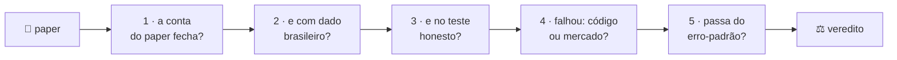
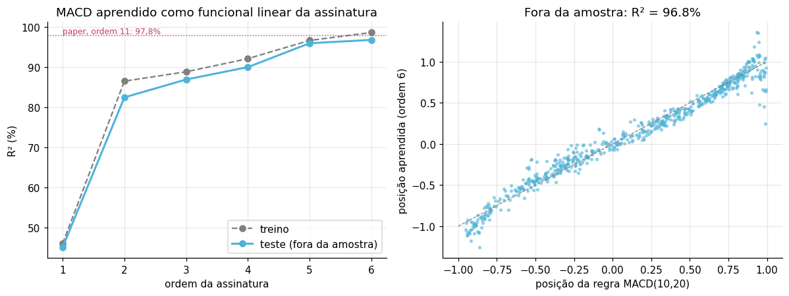
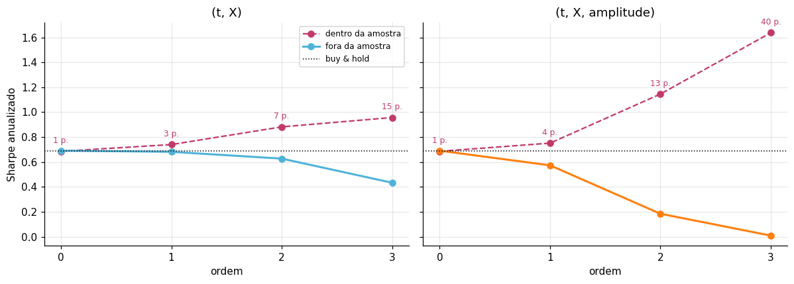

<!-- Paper novo: copie o projeto para papers/NN-<slug>/ (dado ao lado do notebook, caminhos relativos), rode o notebook
     do zero dentro do repo e compare as saídas. Depois: uma linha em "A estante", uma linha por pergunta em "O tribunal",
     uma ficha com a tabela "o paper disse × aqui deu" (✅ 🟡 ❌), o placar, o selo de contagem, a estrutura de pastas,
     o BibTeX em "Como citar" e a referência no CITATION.cff. -->

<div align="center">


# Do Paper ao Pregão

**O paper promete. O pregão confere.**

Papers de finanças quantitativas implementados do zero e testados no mercado brasileiro, com o resultado bonito de
dentro da amostra, o resultado honesto de fora dela e um veredito no fim.

[](#comece)
[](#a-estante)
[](#a-estante)
[](#o-placar)
[](https://arxiv.org/abs/2308.15135)
[](https://doi.org/10.1016/j.jfds.2024.100141)
[](https://instagram.com/gabrielp.pires)
[](LICENSE)


[Como funciona](#como-funciona) · [Comece](#comece) · [A estante](#a-estante) · [O tribunal](#o-tribunal) · [As fichas](#as-fichas) · [Um gostinho](#um-gostinho) · [Sugira um paper](#sugira-um-paper) · [Como citar](#como-citar) · [FAQ](#faq)

</div>

---

> Paper de finanças tem um defeito de fábrica: quem escreve é quem achou o resultado. A figura sai bonita, a amostra é a
> dos Estados Unidos e o CDI não existe.
>
> Aqui cada paper é reimplementado linha por linha e levado para o pregão brasileiro, onde o juro é alto, a história é
> curta e o Ibovespa passou vinte anos sem pagar prêmio sobre o CDI. **Spoiler: a matemática costuma passar. O alfa, nem
> sempre.**

> [!NOTE]
> **Não confundir com *paper trading*.** Lá, o mercado é de verdade e o dinheiro é de mentira. Aqui, o paper é de
> verdade e o dinheiro continua de mentira: nenhum notebook manda ordem para corretora.

<a id="como-funciona"></a>

## 🔬 Como funciona


Cada pasta pega **um** paper e faz com ele o que o próprio paper não teve espaço para fazer: refaz a conta, troca o dado
americano por dado brasileiro, testa fora da amostra e, quando dá errado, descobre se a culpa é do código ou do mercado.

O GIF ao lado resume o paper 01 em quinze segundos. Dentro da amostra, cada ordem a mais da assinatura melhora o
Sharpe, de 0,69 até 1,64, como na figura do paper. Fora da amostra, reestimando todo mês só com o passado, o 1,64 vira
**0,01**. O buy & hold fez 0,69.

Em cada pasta de paper:

- 📓 **o notebook** com as saídas na tela (dá para ler no GitHub sem rodar nada);
- 📊 **o dado** ao lado do notebook, do jeito que sai da fonte;
- 🧾 **a tabela "paper × aqui"** com cada adaptação declarada;
- ⚖️ **o veredito**, afirmação por afirmação.

<br clear="right">



<a id="comece"></a>

## 🚀 Comece em 30 segundos

```bash
git clone https://github.com/gabrielp18/do-paper-ao-pregao.git
cd do-paper-ao-pregao
pip install -r requirements.txt
jupyter lab
```

Abra qualquer `.ipynb` e rode de cima para baixo. O dado mora ao lado do notebook, os caminhos são relativos e nenhum
paper pede chave de API.

**Sem instalar nada?** O paper 01 abre no Colab. Antes de rodar, ponha o dado na sessão com uma célula:
[](https://colab.research.google.com/github/gabrielp18/do-paper-ao-pregao/blob/main/papers/01-signature-trading/sig_trading_ibovespa.ipynb)

```python
!wget -q https://raw.githubusercontent.com/gabrielp18/do-paper-ao-pregao/main/papers/01-signature-trading/base_ibov.xlsx
```

**Sem rodar nada?** O paper 02 vem com um [laboratório interativo](papers/02-private-equity-ml/laboratorio.html):
baixe o arquivo e abra no navegador. Ele funciona offline, sem servidor, com os 600 modelos estimados embutidos, e
refaz a combinação a cada mexida.

<a id="a-estante"></a>

## 📚 A estante

| # | Paper | A promessa | No Brasil | Veredito |
|:-:|---|---|---|---|
| 01 | [**Signature Trading**](#paper-01)<br><sub>Futter, Horvath & Wiese · arXiv 2023</sub><br>[📓](papers/01-signature-trading/sig_trading_ibovespa.ipynb) | qualquer regra que olha o caminho vira linear na assinatura, e a média-variância ganha solução fechada | o MACD sai com R² de **96,8%** fora da amostra; o Sharpe de **1,64** dentro da amostra vira **0,01** fora | 🟡 a conta fecha, o alfa não |
| 02 | [**Machine learning private equity returns**](#paper-02)<br><sub>Tausch & Pietz · JFDS 2024</sub><br>[📓](papers/02-private-equity-ml/codigo/estudo_replicacao_brasil.ipynb) [📄](papers/02-private-equity-ml/relatorio_replicacao_brasil.pdf) [🧪](papers/02-private-equity-ml/laboratorio.html) | uma média de modelos e um boosting tiram o retorno do private equity dos fluxos de caixa | o alisamento do laudo some, mas o beta de mercado do buyout sai **0,62** com **1,15** de verdade | 🟡 a textura fecha, o nível não |

<sub>📓 notebook · 📄 relatório em PDF · 🧪 laboratório interativo · ✅ replicou · 🟡 replicou em parte · ❌ não sobreviveu</sub>

<a id="o-tribunal"></a>

## ⚖️ O tribunal: cinco perguntas para cada paper

Todo paper que entra aqui responde às mesmas cinco perguntas, na mesma ordem. É o que transforma "testei e não deu" em
resultado.

| Pergunta | Paper 01 · Signature Trading | Paper 02 · Private equity |
|---|---|---|
| **1. A conta do paper fecha?**<br><sub>refazer um teorema ou uma figura antes de trocar qualquer coisa</sub> | ✅ o Teorema 2.11 fecha até a **décima casa decimal**; o MACD sai com R² de 96,8% (no paper, 97,8%) | ✅ a forma vetorizada bate com a equação 2 escrita ao pé da letra: diferença de 2 × 10⁻¹⁶ |
| **2. E com dado brasileiro?**<br><sub>trocar o dado e declarar cada adaptação</sub> | Ibovespa diário de 2020 a 2026 e a amplitude de **77 ações** do índice como sinal exógeno | CDI, fatores do NEFIN, IMA-B e seis segmentos de fundos (buyout, venture, infra, imobiliário, crédito, agro) |
| **3. E no teste honesto?**<br><sub>fora da amostra, ou contra um gabarito</sub> | ❌ walk-forward de **52 meses**, reestimando todo mês: a ordem 3 com sinal faz **0,01** de Sharpe | ❌ contra os betas verdadeiros do painel: erro absoluto médio de **0,19**, em betas que vão de −0,4 a 1,15 |
| **4. Se falhou, foi o código ou o mercado?**<br><sub>dado sintético onde a resposta é conhecida</sub> | o mercado: com alfa plantado no caminho, o mesmo código chega a Sharpe **1,75** | a identificação: sem prêmio de mercado sobre o CDI, a função perda achata e o mínimo vira sorteio |
| **5. A diferença passa do erro-padrão?**<br><sub>Sharpe sem erro-padrão é fofoca</sub> | não: com 52 meses, o erro-padrão do Sharpe é **≈ 0,5**, do tamanho do Sharpe do buy & hold | o erro é estável: o sinal trocado do HML de venture aparece em todas as reamostragens do painel |

<a id="as-fichas"></a>

## 🗂️ As fichas

<a id="paper-01"></a>

### 🖋️ 01 · Signature Trading no Ibovespa

> **Futter, O., Horvath, B. & Wiese, M. (2023).** *Signature Trading: A Path-Dependent Extension of the Mean-Variance
> Framework with Exogenous Signals.* [arXiv:2308.15135](https://arxiv.org/abs/2308.15135).
> Imperial College London, Universidade de Oxford e Universidade de Kaiserslautern.

Veio do reel? Você comentou `SIG`. O notebook é este.

Média móvel, MACD, RSI: toda regra técnica é uma função do caminho passado, escolhida à mão. O paper troca "escolher à
mão" por "deixar o dado escolher". A **assinatura** resume o caminho em integrais iteradas (onde ele terminou, a área que
ele varreu, a ordem dos movimentos):

$$
S(X)_{0,t} = \Big(1,\ \int dX,\ \iint dX \otimes dX,\ \dots\Big)
$$

e a posição vira um funcional **linear** dela, com pesos $\ell$:

$$
\xi_t = \langle \ell,\ \hat{\mathbb{Z}}_{0,t} \rangle
\qquad\qquad
\ell^\ast \propto \big(\Sigma^{\mathrm{sig}}\big)^{-1} \mu^{\mathrm{sig}}
$$

Sendo linear, a média-variância tem solução fechada. Markowitz é a ordem zero.

| O paper disse | O Ibovespa respondeu | |
|---|---|:-:|
| o PnL de uma estratégia de assinatura é linear na assinatura lead-lag (Teorema 2.11) | fecha até a décima casa decimal numa janela real de 21 pregões | ✅ |
| uma regra técnica vira funcional linear da assinatura: R² de 97,8% na ordem 11 (Fig. 15) | o MACD(10,20) sai com R² de **96,8%** na ordem 6, **fora da amostra** (2024–2026) | ✅ |
| a fronteira eficiente da assinatura sobe com a ordem (Fig. 8) | dentro da amostra, Sharpe de **0,69 → 0,75 → 1,15 → 1,64** da ordem 0 à 3 | ✅ |
| com alfa no caminho, a Sig-Trading encontra (Seção 5.1.2) | no dado sintético, Sharpe de **1,25** na ordem 1 e **1,75** na 2, contra −0,07 do buy & hold | ✅ |
| *o teste que o paper não faz:* fora da amostra, ela bate o buy & hold? | não. De **0,01 a 0,68**, contra **0,69**, e nenhuma diferença sai do erro-padrão | ❌ |

<table>
  <tr>
    <td width="50%"></td>
    <td width="50%"></td>
  </tr>
  <tr>
    <td><sub>✅ <b>O que replicou.</b> O MACD aprendido como funcional linear da assinatura: R² de 96,8% fora da amostra.</sub></td>
    <td><sub>❌ <b>O que não sobreviveu.</b> 40 parâmetros para 76 meses independentes: Sharpe 1,64 dentro, 0,01 fora.</sub></td>
  </tr>
</table>

**No notebook, você vai:**

- montar o caminho $\hat Z_t = (t,\ X_t,\ f_t)$ com o Ibovespa e a amplitude de mercado (a fração das ações acima da
  média de 20 dias) e calcular a assinatura em numpy puro, pela identidade de Chen;
- conferir o Teorema 2.11 numericamente e estimar $\mu^{\mathrm{sig}}$ e $\Sigma^{\mathrm{sig}}$ pela atribuição de PnL
  por palavra, sem calcular a assinatura lead-lag até a ordem $2M+2$;
- traçar a fronteira eficiente da assinatura dentro da amostra e depois rodar o walk-forward de 15/03/2022 a 29/07/2026,
  com 2 bps de custo por giro, contra buy & hold, momentum de 21 dias e MACD;
- plantar alfa num dado sintético para provar que o código acha alfa quando ele existe;
- medir o custo da flexibilidade (Sharpe dentro × fora, por número de parâmetros) e o erro-padrão do Sharpe, por Lo
  (2002) e por bootstrap em blocos.

> [!WARNING]
> **Viés de sobrevivência.** O painel da amplitude é a carteira *atual* do Ibovespa: ações que saíram do índice no
> período não estão nele. Para uso sério, reconstrua o painel com as carteiras teóricas históricas da B3.

| Arquivo | O que é |
|---|---|
| [`sig_trading_ibovespa.ipynb`](papers/01-signature-trading/sig_trading_ibovespa.ipynb) | o notebook, 12 seções, do caminho ao veredito |
| [`base_ibov.xlsx`](papers/01-signature-trading/base_ibov.xlsx) | preços diários de 02/01/2020 a 26/08/2026: Ibovespa e 77 ações do índice, 1.657 pregões (Yahoo Finance) |

**Flexibilidade não é alfa.** No Ibovespa mensal faltou alfa, não matemática.

<a id="paper-02"></a>

### 🏦 02 · Private equity sem preço

> **Tausch, C. & Pietz, M. (2024).** *Machine learning private equity returns.* The Journal of Finance and Data
> Science, 10, 100141. [doi:10.1016/j.jfds.2024.100141](https://doi.org/10.1016/j.jfds.2024.100141).
> Método base: Driessen, Lin & Phalippou (2012).

Fundo de private equity não tem cota negociada em bolsa. Tem chamada de capital, distribuição e um laudo de patrimônio
que anda alisado, atrasado em relação ao mercado. O paper tira o retorno daí em dois passos: estima um zoo de fatores de
desconto estocástico (SDF) e tira a média dos coeficientes; depois usa *boosting* para achar a parte do retorno que os
fatores públicos não explicam.

O truque computacional desta replicação cabe numa linha. A soma em $t$ não depende da data de capitalização $\tau$:

$$
P_{\tau,i} = \sum_t \Psi_{\tau,t}\, CF_{t,i} = C_\tau \sum_t \frac{CF_{t,i}}{C_t},
\qquad
C_t = \prod_{h \le t} \big(1 + r_h + \beta' F_h + e_h\big)
$$

Um único `cumprod` resolve todas as datas de uma vez. O paper reporta uns três dias em doze núcleos para o boosting;
aqui, com um painel menor e trimestral, o boosting dos seis segmentos levou **149 segundos** num notebook comum.

| O paper disse | O Brasil (painel calibrado) respondeu | |
|---|---|:-:|
| partir do fluxo de caixa, e não do laudo, tira a autocorrelação espúria do retorno | autocorrelação de ordem 1: **0,37 a 0,48** no índice de cotas, **−0,16 a 0,27** na série construída, perto de zero na verdadeira | ✅ |
| a média de coeficientes de muitos modelos fracos dá um modelo multifator único | beta de mercado do buyout: **0,62** estimado, **1,15** verdadeiro. Os 100 modelos concordam entre si e erram juntos | ❌ |
| tratar todos os modelos como válidos ($M^\ast = M$, Seção 4.1) | o modelo com IMA-B absorve a exposição a ações; o filtro por quantil, que o paper descreve e não usa, conserta parte (buyout vai a 0,77) | 🟡 |
| o boosting recupera a série do termo de erro | correlação com o erro verdadeiro entre **0,04 e 0,12**; com 1.200 fundos em vez de 60, **zero** | ❌ |
| retorno total = modelo de fatores + termo de erro | em buyout, os fatores sozinhos têm correlação **0,95** com o retorno verdadeiro; somados ao erro estimado, **0,69** | ❌ |

<table>
  <tr>
    <td width="50%"></td>
    <td width="50%"></td>
  </tr>
  <tr>
    <td><sub>✅ <b>O que replicou.</b> O índice de cotas herda o alisamento do laudo; a série tirada do fluxo de caixa, não.</sub></td>
    <td><sub>❌ <b>O que não sobreviveu.</b> Beta verdadeiro (verde) contra estimado (âmbar): precisão alta, viés alto.</sub></td>
  </tr>
</table>

**Por que falha aqui?** De 2004 a 2025, o Ibovespa rendeu 8,7% ao ano e o CDI, 10,8%. Sem prêmio de mercado, a
derivada do erro de apreçamento em relação ao beta é ruído, a função perda achata e o mínimo passa a depender da amostra,
não do parâmetro. **Identificação é propriedade do prêmio realizado, não do tamanho da amostra.**

**No notebook, você vai:**

- montar os seis fatores brasileiros (CDI, mercado, SMB, HML, WML, IML do NEFIN e IMA-B menos CDI) e ver por que o
  prêmio de ações negativo quebra a identificação;
- gerar um painel de fundos com alisamento de laudo ($\theta = 0{,}45$) e a curva J de cada segmento;
- estimar o zoo de **600 modelos** (100 por segmento), tirar a média dos coeficientes e medir a faixa de betas que a
  função perda não distingue;
- rodar o *componentwise L₂ boosting* do termo de erro e compará-lo com o erro verdadeiro;
- fazer dois experimentos que o paper não faz: reamostrar o painel (o erro é estável) e crescer de 60 para 1.200 fundos
  (o termo de erro continua sem identificação).

> [!WARNING]
> **Os números vêm de um painel calibrado, não dos fluxos reais da CVM.** Mercado e CDI estão ancorados nos retornos
> anuais reais de 2004 a 2025, e os fundos são simulados com parâmetros conhecidos. É de propósito: com gabarito dá para
> medir o erro do estimador, o que é impossível com dado real. E o gerador usa a mesma forma funcional que o estimador
> assume, ou seja, este é o cenário **mais favorável** ao método. Para trocar pelo dado real, use
> `data_br.load_factors(real=True)` e `cashflows.load_cvm_fip(...)`, que leem o Informe de FIP da CVM.

```bash
cd papers/02-private-equity-ml/codigo
jupyter lab estudo_replicacao_brasil.ipynb    # o estudo comentado, uns 10 minutos
python -m br_pe_sdf.run_all                   # o mesmo resultado, sem narrativa
python -m br_pe_sdf.laboratorio               # regera o laboratório interativo
```

| Arquivo | O que é |
|---|---|
| [`codigo/estudo_replicacao_brasil.ipynb`](papers/02-private-equity-ml/codigo/estudo_replicacao_brasil.ipynb) | o estudo comentado e executado, 14 seções, dos fatores brasileiros ao relatório (a última célula remonta o PDF e pede o [`wkhtmltopdf`](https://wkhtmltopdf.org/) instalado) |
| [`codigo/br_pe_sdf/`](papers/02-private-equity-ml/codigo/br_pe_sdf) | o pacote: SDF, combinação, boosting, gerador de fluxos, leitor do Informe de FIP e figuras |
| [`relatorio_replicacao_brasil.pdf`](papers/02-private-equity-ml/relatorio_replicacao_brasil.pdf) | o relatório final, 13 páginas |
| [`laboratorio.html`](papers/02-private-equity-ml/laboratorio.html) | o laboratório interativo, um arquivo só, offline |
| [`METODOLOGIA.md`](papers/02-private-equity-ml/METODOLOGIA.md) | cada adaptação para o Brasil e as limitações |
| [`resultados/`](papers/02-private-equity-ml/resultados) | as tabelas em CSV e as figuras do relatório |

**A série com boosting acerta a textura (volatilidade, choques, ausência de persistência falsa) e erra o nível.** Serve
para risco, que depende de covariância. Não serve para medir alfa, que depende do nível.

<a id="um-gostinho"></a>

## 🧪 Um gostinho

A assinatura parece coisa de físico, mas cabe em dez linhas de numpy. E dá para ver, com dois caminhos de brinquedo, por
que ela consegue imitar qualquer regra técnica: ela sabe **a ordem** em que as coisas aconteceram.

```python
import numpy as np

def assinatura(caminho, M=2):
    """Assinatura truncada no nível M de um caminho linear por partes (identidade de Chen)."""
    D = caminho.shape[1]
    S = [np.ones(1)] + [np.zeros(D ** k) for k in range(1, M + 1)]
    for d in np.diff(caminho, axis=0):                          # cada pedaço reto do caminho...
        E = [np.ones(1)]
        for j in range(1, M + 1):
            E.append(np.outer(E[-1], d).ravel() / j)            # ...vira exp(d) = (1, d, d⊗d/2!, ...)
        S = [sum(np.outer(S[i], E[n - i]).ravel() for i in range(n + 1)) for n in range(M + 1)]
    return S                                                    # e os pedaços se multiplicam (Chen)

# dois meses do mesmo ativo, em (tempo, retorno acumulado): mesmo começo, mesmo fim
caiu_e_subiu = np.array([[0, 0], [0.5, -0.10], [1, 0.05]])
subiu_e_caiu = np.array([[0, 0], [0.5, +0.20], [1, 0.05]])

for nome, X in [("caiu e subiu", caiu_e_subiu), ("subiu e caiu", subiu_e_caiu)]:
    _, nivel1, nivel2 = assinatura(X)
    levy = (nivel2[1] - nivel2[2]) / 2                           # ½(S¹² − S²¹): a área de Lévy
    print(f"{nome}:  nível 1 = {nivel1.round(2)}   área de Lévy = {levy:+.3f}")
```

```text
caiu e subiu:  nível 1 = [1.   0.05]   área de Lévy = +0.063
subiu e caiu:  nível 1 = [1.   0.05]   área de Lévy = -0.088
```

**Spoiler:** o nível 1 é igual nos dois (o mês terminou em +5%). Quem separa "caiu primeiro" de "subiu primeiro" é o
nível 2, a área entre o caminho e a corda. Um MACD, que dá mais peso ao que aconteceu por último, depende exatamente
disso. A função é a mesma do notebook, em versão de bolso: as duas batem até o último bit. [Abrir o notebook completo →](papers/01-signature-trading/sig_trading_ibovespa.ipynb)

<a id="regras-da-casa"></a>

## 📏 Regras da casa

1. **Primeiro o paper, depois o Brasil.** Antes de trocar o dado, a pasta refaz uma conta ou uma figura do original.
2. **Toda adaptação é declarada.** Frequência, taxa livre de risco, fatores, fonte do dado: está escrito o que mudou e
   por quê.
3. **Dentro da amostra é trailer.** O filme é fora dela.
4. **Fracasso ganha teste com gabarito.** Dado sintético, onde a resposta é conhecida, separa "o código errou" de "o
   mercado não tem".
5. **Sharpe sem erro-padrão é fofoca.**
6. **O crédito é dos autores, o erro é meu.** Toda pasta aponta para o paper original. Os autores não revisaram estas
   implementações.
7. **Não é recomendação.** Nenhum notebook diz o que comprar.

<a id="o-placar"></a>

## 🏆 O placar

| Contador | Quanto |
|---|---|
| 📄 Papers no tribunal | **2** |
| ✅ Afirmações que replicaram | **5** |
| 🟡 Replicaram em parte | **1** |
| ❌ Não sobreviveram ao Brasil | **4** |
| 🧮 Casas decimais em que o Teorema 2.11 fecha no Ibovespa | **10** |
| 📉 Sharpe perdido entre dentro e fora da amostra (paper 01, ordem 3 com sinal) | **1,63** |
| ⏱️ Boosting do paper 02: o paper reporta ~3 dias em 12 núcleos; aqui, os seis segmentos | **149 s** |
| 🔑 Chaves de API necessárias | **0** |

<sub>🟦 paper na estante · ⬜ espaço livre</sub>

🟦🟦⬜⬜⬜⬜⬜⬜⬜⬜ &nbsp; a estante tem espaço. [Qual paper você quer ver no pregão?](#sugira-um-paper)

<a id="sugira-um-paper"></a>

## 📬 Sugira um paper

Tem um paper que promete demais? [Abra uma issue com o modelo "Sugerir um paper"](https://github.com/gabrielp18/do-paper-ao-pregao/issues/new?template=sugerir-paper.yml):
o link, a promessa em uma frase e, se souber, o dado brasileiro que serve. Os que têm dado público (B3, CVM, Tesouro,
Banco Central, ANBIMA, NEFIN) furam a fila.

Achou um erro numa implementação? Issue também. Errar em público é o melhor tipo de erro: aparece, é corrigido e todo
mundo aprende junto.

<a id="como-citar"></a>

## 📖 Como citar

Se este código ajudou no seu trabalho, cite **primeiro o paper original**, que é de onde vem a ideia. O botão "Cite this
repository", aqui do lado, usa o [`CITATION.cff`](CITATION.cff).

```bibtex
@misc{futter2023signature,
  title         = {Signature Trading: A Path-Dependent Extension of the Mean-Variance Framework with Exogenous Signals},
  author        = {Futter, Owen and Horvath, Blanka and Wiese, Magnus},
  year          = {2023},
  eprint        = {2308.15135},
  archivePrefix = {arXiv},
  primaryClass  = {q-fin.PM}
}

@article{tausch2024machine,
  title   = {Machine learning private equity returns},
  author  = {Tausch, Christian and Pietz, Marcus},
  journal = {The Journal of Finance and Data Science},
  volume  = {10},
  pages   = {100141},
  year    = {2024},
  doi     = {10.1016/j.jfds.2024.100141}
}

@software{pires2026paperpregao,
  title  = {Do Paper ao Pregão: papers de finanças quantitativas implementados e testados no mercado brasileiro},
  author = {Pires, Gabriel},
  year   = {2026},
  url    = {https://github.com/gabrielp18/do-paper-ao-pregao}
}
```

<a id="estrutura"></a>

## 📂 Como o repositório está organizado

```text
do-paper-ao-pregao/
├── papers/
│   ├── 01-signature-trading/
│   │   ├── sig_trading_ibovespa.ipynb
│   │   └── base_ibov.xlsx                    ← Ibovespa e 77 ações, 2020–2026
│   └── 02-private-equity-ml/
│       ├── codigo/
│       │   ├── estudo_replicacao_brasil.ipynb
│       │   └── br_pe_sdf/                    ← o pacote (sdf, combinação, boosting...)
│       ├── resultados/                       ← tabelas em CSV e figuras
│       ├── relatorio_replicacao_brasil.pdf
│       ├── laboratorio.html                  ← abre no navegador, offline
│       ├── METODOLOGIA.md
│       └── README.md
├── assets/                                   ← logo e prévia social (geradas por código), GIF e figuras
├── .github/ISSUE_TEMPLATE/sugerir-paper.yml
├── CITATION.cff
├── requirements.txt
└── LICENSE
```

<a id="faq"></a>

## ❓ Perguntas que sempre aparecem

<details>
<summary><b>Então o paper está errado?</b></summary>
<br>
Não. A matemática dos dois papers fecha, e as pastas mostram isso antes de qualquer outra coisa. O que muda é a pergunta:
o paper mostra que o método <i>pode</i> funcionar; aqui a pergunta é se ele funciona <i>no Brasil</i>, com a amostra que
existe. Os próprios autores deixam essas questões abertas: o Signature Trading aponta a robustez da estimação como
problema em aberto, e o Tausch & Pietz alerta para os extremos do termo de erro.
</details>

<details>
<summary><b>Por que tanto ❌?</b></summary>
<br>
Porque é isso que replicar significa. Um paper que não sobrevive ao Brasil, com o motivo identificado, ensina mais do
que dez figuras bonitas dentro da amostra. E todo ❌ daqui vem com o teste que separa defeito do método de falta de
sinal no mercado.
</details>

<details>
<summary><b>Por que testar no Brasil?</b></summary>
<br>
Porque o Brasil quebra premissas que nos Estados Unidos passam despercebidas. O CDI alto compete com qualquer
estratégia, o prêmio das ações sobre o CDI foi perto de zero por duas décadas, a história dos dados é curta e muitos
mercados são concentrados. Se um método aguenta isso, ele é robusto. Se não aguenta, a gente descobre onde ele quebra.
</details>

<details>
<summary><b>Preciso saber o que é uma integral iterada?</b></summary>
<br>
Não para começar. Rode o <a href="#um-gostinho">gostinho</a>: dois caminhos, mesmo começo e mesmo fim, e um número que
sabe quem caiu primeiro. A teoria vem nos notebooks, em pedaços pequenos, sempre com a conta antes do código.
</details>

<details>
<summary><b>Por que o paper 02 usa fundos simulados?</b></summary>
<br>
Porque com dado real não existe gabarito: o estimador devolveria números e ninguém saberia que estão errados. O painel
calibrado tem betas verdadeiros conhecidos e mercado e CDI ancorados nos retornos reais de 2004 a 2025. O pacote já lê o
Informe de FIP da CVM; trocar de fonte é um parâmetro.
</details>

<details>
<summary><b>Posso usar no meu trabalho, na faculdade, no TCC?</b></summary>
<br>
Pode. O código é MIT: use, mude e redistribua, mantendo o aviso de licença. Se for publicar, cite o paper original de
cada pasta (o BibTeX está em <a href="#como-citar">Como citar</a>).
</details>

<details>
<summary><b>Isso é recomendação de investimento?</b></summary>
<br>
Não. É educação. Nenhum notebook diz o que comprar, e nenhum manda ordem. Eles mostram como a conta funciona, inclusive
quando ela não funciona.
</details>

---

<div align="center">
<sub>
O logo é o Ibovespa de janeiro de 2020 a agosto de 2026, mês a mês, desenhado numa folha de paper
(<a href="assets/logo.py"><code>assets/logo.py</code></a>). A mancha âmbar entre a linha e a corda é a área de Lévy,
o nível 2 da assinatura. É o primeiro paper da estante, desenhado na capa.
<br><br>
Feito com dado público, café e uma quantidade irresponsável de walk-forwards por
<a href="https://instagram.com/gabrielp.pires">@gabrielp.pires</a>.
<br>
Irmãos: <a href="https://github.com/gabrielp18/do-reel-ao-repo">Do Reel ao Repo</a> ·
<a href="https://github.com/gabrielp18/financas-quant-do-zero">Finanças Quant do Zero</a>
</sub>
</div>
